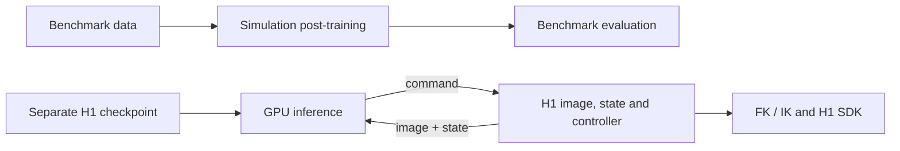

<p align="center"></p>
<h1 align="center">Zerith-VA</h1>
<p align="center">Simulation post-training · H1 inference and robot control</p>
<p align="center"><strong>English</strong> · <a href="README_zh-CN.md">简体中文</a></p>

Zerith-VA combines Z-VLA benchmark post-training with a separate H1 deployment
stack. In deployment, the GPU host runs model inference and the H1 host runs
image capture, state estimation, IK and SDK joint control.

> [!NOTE]
> This is a source release candidate. Model weights, datasets, visual assets,
> SDK binaries, robot descriptions and the native IK provider are not bundled.
> Complete the [publication checklist](RELEASE_CHECKLIST.md) before release.

Model weights will be released separately on Hugging Face:
[model repository (placeholder)](https://huggingface.co/REPLACE_WITH_ORG/Zerith-VA).
Replace this placeholder when the model repository is published. It is not a
working download link. Each model release will include its own permissions and
license terms; the source-code license does not grant rights to those weights.

## Contents

- [Architecture](#architecture)
- [Simulation post-training](#simulation-post-training)
- [H1 deployment](#h1-deployment)
- [Protocol and motion checks](#protocol-and-motion-checks)
- [Validation and license](#validation-and-license)

## Architecture

| Package | Responsibility | Host |
| --- | --- | --- |
| `simulation/` | Benchmark data preparation, post-training, export and evaluation | Training/simulator |
| `deployment/shared/` | Versioned HTTP client and shared contract | GPU and H1 |
| `deployment/inference/` | Model, visual encoders and inference service | GPU |
| `deployment/robot/` | H1 cameras, SDK adapter, FK/IK and control loop | H1 |



The three deployment packages are independently installable. The H1 host does
not need PyTorch or model weights; the GPU host does not need the H1 SDK.
Simulation exports use benchmark-specific codecs and cannot be loaded as H1
policies without a separately trained compatible checkpoint.

## Simulation post-training

Supported benchmark keys are `libero`, `libero-plus`, `metaworld`,
`robotwin` and `robodojo`. Each benchmark has its own state/action codec.
Clone this repository and run the public simulation workflow directly from
its `simulation/` source directory. Use Conda to manage separate environments
for preparation/training/model serving and for each selected official simulator.
The suggested core environment is Python 3.12, PyTorch 2.10.0/CUDA 13.0 and
Megatron-Core 0.19.0:

```bash
conda create -n zvla-train python=3.12 pip
conda activate zvla-train
cd /path/to/Zerith-VA/simulation
python -m pip install torch==2.10.0 torchvision==0.25.0 --index-url https://download.pytorch.org/whl/cu130
python -m pip install megatron-core==0.19.0
python -m pip install -r requirements.txt
```

The project source needs no pip installation. The lightweight HTTP client
needs NumPy and requests in the simulator's Conda environment. Install only the
selected benchmark's official environment, native dependencies and assets: LIBERO and
LIBERO-Plus use their corresponding checkouts; MetaWorld uses its own environment;
RoboTwin and RoboDojo use their official harnesses, including the required
XPolicyLab/conda environments for RoboDojo. Simulator libraries are imported
when that benchmark is selected. The source contains the project's training
launcher, benchmark recipe generator and evaluation bridge scripts/configs; external
simulator source, models and assets are installed separately.

For a standalone HTTP client/launcher, the optional
`simulation/environment-client.yml` supplies Python 3.11, NumPy and requests.
From `simulation/`, create it with:

```bash
conda env create -n zvla-client -f environment-client.yml
```

This provides a base for roles such as RoboDojo's `POLICY_ENV`; add that
role's official XPolicyLab dependencies as needed. Each official simulator
keeps its own environment and Python requirements.

Attention prefers the optional custom FlashAttention-3 extension for eligible
Hopper SM90 boolean masks, FP16/BF16 tensors and 128-wide heads; other cases use
PyTorch SDPA. The extension source, pinned CUTLASS headers and upstream notices
are included in the simulation source tree. Install
simulators in separate environments using their upstream instructions. Obtain the base
`zvla-base.safetensors` checkpoint, Wan/VGGT source and visual weights
separately; place the checkpoint in `simulation/checkpoints/`.
Developers are responsible for keeping Wan VAE, UMT5/tokenizer, VGGT and
preprocessing consistent between data preparation and online inference.

To prebuild the optional extension on a Hopper GPU, install a compatible CUDA
toolkit with `nvcc`, a C++ compiler and Ninja, then run in the simulation
environment:

```bash
python -m pip install ninja
python -c 'from fa2_custom_mask import prebuild_flash_attention3; print(prebuild_flash_attention3())'
```

Eligible calls can build the extension on first use and fall back to SDPA if
the build fails. Set `ZVLA_REQUIRE_FLASH_ATTENTION3=1` to require it for eligible
boolean-mask calls and reject a missing or broken build. Source and Python/
PyTorch/CUDA ABI fingerprints isolate build caches. The bundled CUTLASS tree
is the default; `ZVLA_FA3_CUTLASS_ROOT` may select an identical pinned snapshot,
whose contents must pass the same fingerprint check. Changing attention
backends can change numerical results, speed and memory use; GPU compilation
and parity remain part of the deferred validation.

| Benchmark | Demonstration source | `--source` points to |
| --- | --- | --- |
| `libero` | [Modified LIBERO RLDS](https://huggingface.co/datasets/openvla/modified_libero_rlds), revision `6ce6aaaaabdbe590b1eef5cd29c0d33f14a08551` | Root containing the four RLDS suites |
| `libero-plus` | [LIBERO-Plus LeRobot](https://huggingface.co/datasets/Sylvest/libero_plus_lerobot), revision `22c57433fef692b5b9ecc0795344daac7fa867a5` | LeRobot root with `meta/info.json` |
| `metaworld` | [Evo1 MetaWorld](https://huggingface.co/datasets/MINT-SJTU/Evo1_MetaWorld_Dataset), revision `612c4e83d0e3b4e0be5227970bd8f5f07fc0c488` | LeRobot root with `meta/info.json` |
| `robotwin` | [RoboTwin 2.0](https://huggingface.co/datasets/TianxingChen/RoboTwin2.0), revision `981c92aa34d8f94d4cff47e0d5bc2f7d4e0af042` | Root with `dataset/<task>/demo_clean.zip` |
| `robodojo` | [RoboDojo](https://huggingface.co/datasets/RoboDojo-Benchmark/RoboDojo), revision `91f76c28d93dd20c5fa46ce6a5a1d96a4f384acd` | Extracted `ee_lerobot_v30` |

Example LIBERO-Plus preparation and training:

```bash
python -m zvla.posttrain prepare --bench libero-plus \
  --source data/raw/libero-plus --output data/libero-plus \
  --wan-repo assets/Wan2.2 --wan-model assets/Wan2.2-TI2V-5B \
  --vggt-repo assets/vggt --vggt-model assets/VGGT-1B --device cuda:0
python -m zvla.posttrain train --bench libero-plus --data data/libero-plus \
  --checkpoint checkpoints/zvla-base.safetensors --output runs/libero-plus \
  --gpus 8 --batch-size 10
```

`--limit 2` during preparation checks a small pipeline; use a different
output directory for the full dataset. `--gpus` is GPUs per node and
`--batch-size` is per GPU; global batch is nodes × GPUs per node × batch.
Changing GPU count does not automatically adjust learning rate or enable
gradient accumulation. Resume only with matching data, topology and settings.
Multi-node training uses the same data/output paths on every node and the
`--nodes`, `--node-rank`, `--master-addr` and `--master-port` options.
Use `train --resume` only with a training directory you created or whose source
you trust.
The prepared dataset includes `dataset.json`, `codec.json`, text embeddings
and per-episode arrays; padding and future-image targets are masked within
each episode.

If preparation is interrupted, rerun the same `prepare` command with
`--resume`. It checks the raw-source files, ordered episodes (including RGB
images and instructions), encoder weights and tokenizer, code, software
settings and `--limit` against `prepare_manifest.json` before loading encoders.
Completed episode arrays and the final dataset files are also checked by
content hash. Matching completed episodes are reused; an unfinished episode
is encoded again. A completed dataset is validated without loading encoders
or rewriting its files. Resume still reads and hashes the inputs and decodes
images on the CPU, so validation takes time on large datasets.

An input, asset, configuration or software change requires a new output
directory. Old caches without identity receipts and damaged completed caches
are rejected. Keep source/model files unchanged during preparation, and keep
the output directory separate from all source and encoder asset directories.
Model files may be symlinks to downloaded blobs; nested directory symlinks
are rejected to avoid untracked inputs. One process may prepare each output
directory at a time. The final `dataset.json` appears only after the episode,
statistics and text files have been committed successfully; start training
after `prepare` completes.

Replace the example checkpoint filename with the one created by training:

```bash
python -m zvla.posttrain export --run runs/libero-plus \
  --checkpoint runs/libero-plus/checkpoints/model-step-030000-epoch-XX.safetensors \
  --output artifacts/libero-plus
python -m zvla.posttrain serve --artifact artifacts/libero-plus \
  --wan-repo assets/Wan2.2 --wan-model assets/Wan2.2-TI2V-5B \
  --vggt-repo assets/vggt --vggt-model assets/VGGT-1B --device cuda:0 --port 8000
```

Activate the matching official simulator's Conda environment with NumPy and
requests available, then run the benchmark client from this repository's
`simulation/` directory. The RoboTwin/RoboDojo launcher adds this source root
to `PYTHONPATH` for official harness subprocesses:

```bash
conda activate YOUR_SIM_ENV
cd /path/to/Zerith-VA/simulation
python -m zvla.posttrain eval --bench libero-plus \
  --benchmark-root /path/to/LIBERO-plus --suite libero_spatial \
  --episodes 1 --server http://127.0.0.1:8000 --output results/plus-spatial
```

LIBERO/Plus suites are `libero_spatial`, `libero_object`, `libero_goal`
and `libero_10`. RoboTwin and RoboDojo use their official simulator
harnesses. Full-model training and closed-loop benchmark success still require
validation with the actual assets.

## H1 deployment

### Install by host

The GPU host needs Linux x86-64, CUDA/BF16 support and a compatible model
bundle. Plan for 64 GB host RAM, about 60 GB free disk and preferably 48 GB
GPU memory as starting targets; measure actual peak use. The H1 host needs
Linux x86-64, a Python ABI matching the SDK, camera and motor services,
robot descriptions and native IK.

From the repository root, install the GPU packages in a suitable environment:

```bash
python3.10 -m venv .venv
source .venv/bin/activate
python -m pip install torch==2.10.0 torchvision==0.25.0 --index-url https://download.pytorch.org/whl/cu128
python -m pip install ./deployment/shared ./deployment/inference
cd deployment
cp configs/server.example.json configs/server.local.json
cp configs/visual_assets.example.json configs/visual_assets.local.json
```

On the H1 host, use the SDK-compatible Python environment and install from
the repository root:

```bash
python -m pip install ./deployment/shared ./deployment/robot
cd deployment
zwam robot
cp configs/h1.example.json configs/h1.local.json
```

`zwam robot` defaults to an **offline coordinate check**; it does not
initialize the SDK or command motion.

### Public SDK and IK

The [Zerith public SDK](https://github.com/inFpZero/zerith_public_sdk)
contains versioned H1 motion and camera Python libraries. Choose a version
matching the robot firmware and Python ABI. For example, its
`H1_SDK_1.3.9` tree has a Python 3.10 motion library in
`h1_sdk_v1.3.9_python3.10/lib/` and a separate
`camera_sdk_python/camera_client*.so`. Install the SDK separately at a local
path; the example config uses `deployment/external/zerith_public_sdk/`.
Set `sdk_root` and `camera_sdk_root` to the motion and camera library directories
of that installation; absolute paths outside this checkout are supported.
Install its camera dependencies in the same environment and run the vendor
examples first. Our package includes the adapter only: SDK source, binaries
and vendor examples are not bundled or automatically installed. The SDK's
own terms apply independently of the project's Apache-2.0 license.

The public SDK supplies camera and motor access. **A separate compatible
planner/native IK provider and URDF/collision assets are still required.**
Set `planner_source` and `planner_factory` in `configs/h1.local.json`.
The adapter expects `processors.fast_ik_backend`,
`fast_ik_cpp.FastIKSolver`, a waist-fixed arm model and
`body_eef_poses(q19)` returning two poses in `body_yaw_link`. The default
factory name is `vla_source:build_planner`. Verify the binaries, mappings,
camera names and timestamp clock on the exact robot before enabling motion.
The planner must expose finite 19-joint bounds, `arm_control_indices`,
`root_from_body`, both URDF end-effector link names and
`body_eef_poses(q19)`. The waist-fixed arm IK must not move the waist a
second time. The adapter validates FK residuals and joint steps before SDK
publication; an external native call that hangs cannot be interrupted by
the wrapper's elapsed-time check.

### Assets and configuration

Obtain the H1 checkpoint, Wan VAE, VGGT source/weights, text bank and SHA-256
values from the model provider. The Hugging Face link above is a placeholder
until the separate model release is published. Expected local layout under
`deployment/`:

```text
assets/
  policy/model.safetensors
  policy/manifest.json
  wan/Wan2.2_VAE.pth
  vggt/config.json
  vggt/model.safetensors
  text/tasks.json
  text/text_embeddings.npy
  text/text_manifest.json
external/
  Wan2.2/
  vggt/
  zerith_public_sdk/
```

A provider's `fam-wam-policy-v5.2-action20-linear-g4d-teacher` export
must be converted with `zwam prepare --source /path/to/exported-policy
--output assets/policy`; a `zwam-h1-inference-v1` bundle can be placed at
`assets/policy` directly. Raw training checkpoints lack the deployment
manifest. The loader checks exact model keys, shapes, codec statistics and
asset hashes. The text bank stores exact task strings and finite float16
embeddings with shape `[len(tasks),64,4096]`; new prompts need matching
embeddings.
The policy manifest identifies the structural config, normalization
statistics and hashes of the model and VAE. Visual config pins Wan/VGGT
source-tree fingerprints and weight hashes. Use `zwam source-hash` on a
reviewed checkout; a hash calculated after receiving an untrusted file
establishes identity, not provenance. Keep external source and assets
read-only while serving.

H1 deployment uses the current three-camera Wan2.2 VAE, UMT5 and VGGT
interfaces. Bundle preparation, policy/session loading and `zwam doctor`
check the config before reading model weights or initializing the GPU:
`text_dim=4096`, `text_prefix_length=64`, `latent_channels=48`,
`canonical_latent_height=42`, `canonical_latent_width=14`,
`geometry_feature_dim=2048`, `geometry_tokens_per_camera=49`,
`camera_slots=3`, `max_active_camera_slots=3` and `patch_size=2`.
Omitted interface fields use production defaults; explicitly supplied dimensions
must be integers, and float or bool values are rejected.
`text_length` may be any integer at least 64; larger logical lengths retain a
zero suffix after the 64-slot prefix. These interface checks add no restrictions
to internal network widths, layer counts or RoPE settings.

H1 training observations and absolute left/right hand targets must use the
deployment frame `body_yaw_link`. The provider's
`normalization_stats.command_contract` must declare this `pose_frame` and
nonempty `frame_evidence`; bundle preparation, offline diagnostics and policy
loading reject a missing, unresolved or different frame before loading weights.
The project maintainer selected this target-frame definition; physical data and
hardware agreement remain part of the deferred validation. Retain
`physical_semantics_verified: false` until that validation is performed. Frame
checking does not apply a coordinate transform. Existing statistics are bound
to the checkpoint, so a manifest-only frame edit cannot migrate old weights;
the provider must export matching statistics and weights from correctly framed
data.

H1 hand positions use metres. Waist slots `20:23` are
`waist_joint1.position`, `waist_joint2.position`, `waist_joint3.position`:
lift in metres, pitch in radians and yaw in radians, as confirmed by the
maintainer for the raw training data. The command contract must contain
`position_unit: "m"`, `waist_units: ["m","rad","rad"]` and that exact
`waist_joint_order`. An optional `waist_semantics` must be
`["lift","pitch","yaw"]`; omitting it keeps an already correct legacy
statistics fingerprint intact. Packaging, diagnostics and loaders reject
unknown units or a different order before reading model weights. Values are
passed through the SDK mapping without a unit conversion or home offset;
SDK units, signs and zero positions remain part of hardware validation.

All deployment commands below run from `deployment/`. Relative paths in
the example configs resolve from the current working directory. Fill the
ignored `*.local.json` files with the provider's verified paths and digests.
The server uses `configs/server.local.json` and
`configs/visual_assets.local.json`; the H1 host uses
`configs/h1.local.json`. On the GPU host:

```bash
zwam doctor --role server --config configs/server.local.json --verify-assets
zwam serve --config configs/server.local.json
```

On H1, keep `commissioned: false` during setup:

```bash
zwam doctor --role h1 --config configs/h1.local.json
zwam robot --check-server --config configs/h1.local.json
```

`zwam doctor` checks file/configuration placement without importing the SDK,
opening cameras or moving hardware. Non-loopback serving requires a
`ZWAM_API_KEY` of at least 32 characters on both hosts and a protected
SSH/TLS channel. Keep secrets out of JSON and command arguments.

After on-site commissioning, set `commissioned: true` in the ignored H1
config and start explicitly:

```bash
bash scripts/start_h1.sh --config configs/h1.local.json --execute
```

The operator types `EXECUTE` to initialize, inspects posture and image
views, then presses Enter to start inference. Stop the H1 controller before
stopping the server. Ctrl+C or `bash scripts/stop_h1.sh` requests normal
deinitialization, which can move hardware. A physical emergency stop is
required for motion hazards.

## Protocol and motion checks

The server receives a task instruction, three images (head, left wrist,
right wrist) and measured `state`. It returns absolute `command` targets.
State and command each contain 23 values:

| Indices | Meaning | Units/frame |
| --- | --- | --- |
| 0:3, 10:13 | Left/right end-effector position | Metres in `body_yaw_link` |
| 3:9, 13:19 | Left/right rotation 6D | First two matrix columns |
| 9, 19 | Left/right gripper | State 0–1; command 0–1.5 |
| 20:23 | Waist lift, pitch, yaw | Metres, radians, radians |

The wire identifier is `zwam-h1-command23-http-npz-v3`. Upgrade the shared
client and inference server together. `GET /health` declares v3; the client
checks this metadata and explicitly rejects older or incompatible protocols.
New clients send `X-ZWAM-Protocol: zwam-h1-command23-http-npz-v3` on every
request; `POST /reset`, `/infer` and `/release` reject missing or incorrect
versions before reading the body or changing session state, while `GET /health`
does not require this header.
`POST /infer` accepts `images` (uint8 `[T,3,H,W,3]`), `state23`
(float32 `[23]`) and `valid23` (bool `[23]`); it returns `commands`
(float32 `[4,23]`) and `valid` (bool `[4,23]`). The first request after
reset has one image frame; later requests have four fresh frames. The model
predicts 16 rows and the service exposes the first four. Tokens and sequence
numbers enforce session ownership and ordering. Inference requests are never
retried automatically. An ambiguous inference timeout requires an explicit
reset followed by fresh observations.
The service exposes `GET /health`, `POST /reset`, `POST /infer` and
`POST /release`. Non-loopback requests need bearer authorization; the
episode token is carried separately in `X-Episode-Token` and infer requests
carry `X-Sequence`. Expanded NPZ size is limited to 64 MiB. Unknown members,
pickle/object arrays and nonfinite state/command values are rejected.

Before its first reset request, the client generates and retains a secret
episode token. If that reset response is lost, the client becomes inactive
but keeps the token: call `reset(prompt, seed)` explicitly on the same client
to reinitialize the session, or `close()` to release ownership. The existing
token owner retains exclusive ownership even when the server session is
inactive. Ownership has no TTL or automatic takeover by another client.

SDK21 order is left arm 7 + gripper, right arm 7 + gripper, waist 3, head 2.
The adapter's control19 order is waist 3, left arm 7, right arm 7, head 2.
It computes measured end-effector poses with FK, solves arm targets in a
waist-fixed frame and sends joint commands in SDK mode 3. Verify joint signs,
units, hand offsets, camera order and image orientation for the exact robot.

Default execution is disabled. Before commissioning, check SDK ABI and robot
revision, URDF/meshes, FK/IK frames, camera alignment, joint limits, vendor
services and the physical emergency stop. Use checkpoint-matched offline
observations to compare decoded commands and FK before running hardware.
Only one policy controller may publish commands.
The client solves both arms in a waist-fixed frame, checks gripper and waist
targets separately, and keeps the initial measured head targets. A failed IK
solve pauses and discards the old action chunk on operator recovery. A partial
low-level SDK send remains a latched fault; never resume an uncertain frame.

| Software check | Limit |
| --- | --- |
| End-effector target change | 0.10 m / 0.5 rad per hand |
| IK FK residual | 0.001 m / 0.01 rad per hand |
| IK budget | Up to 8 calls / 20 ms around native calls |
| Arm command change | 0.25 rad maximum component |
| Waist step | 0.03 m / 0.2 rad / 0.2 rad |
| Image age / cross-camera skew | 0.25 s / 0.10 s |

These checks are application-level, not manufacturer-certified safety
limits. IK failure pauses for operator recovery; a partial SDK send latches a
fault. Software pause is not an emergency stop. The four-action loop uses a
nominal 30 Hz schedule; inference and IK add latency.

## Validation and license

Run synthetic checks from the repository root:

```bash
python -m pip install -e ./deployment/shared -e ./deployment/inference -e ./deployment/robot
python -m pip install pytest ruff
pytest -q deployment/tests
PYTHONPATH=simulation python -m pytest -q simulation/tests
python scripts/check_release.py
```

Build the three deployment wheels separately and run
`python scripts/check_dist.py deployment/dist` to check package boundaries.
Before hardware use, replay matching observations on the GPU, compare
decoded actions and IK/FK with a trusted reference, measure latency/memory,
and commission the exact H1 on site. Synthetic tests do not establish GPU
parity or physical safety.

For offline GPU replay, prepare a local NPZ with `images` (uint8
`[N,3,H,W,3]`) and `states` (float32 `[N,23]`), then run from
`deployment/`:

```bash
zwam replay --input /path/to/offline.npz --url http://127.0.0.1:55558 \
  --prompt 'EXACT_TEXT_BANK_INSTRUCTION' --steps 3
```

Replay sends recorded observations only. It does not initialize or move the
robot and does not measure closed-loop task success.

Zerith-VA code is released under [Apache-2.0](LICENSE), with original
attribution in [NOTICE](NOTICE) and the [rights map](LICENSE_POLICY.md).
The Zerith Robotics logo is displayed with authorization for project
identification. Its rights remain with Zerith Robotics; the artwork is excluded
from the code license and this repository grants no additional branding rights.
Commercial use of separately released Zerith-owned model weights and
derived weights requires prior written permission from Zerith Robotics.
No weights are included; see the [model-weight policy](MODEL_LICENSE_POLICY.md).
Contributions follow [CONTRIBUTING.md](CONTRIBUTING.md); vulnerability reports
follow [SECURITY.md](SECURITY.md).
