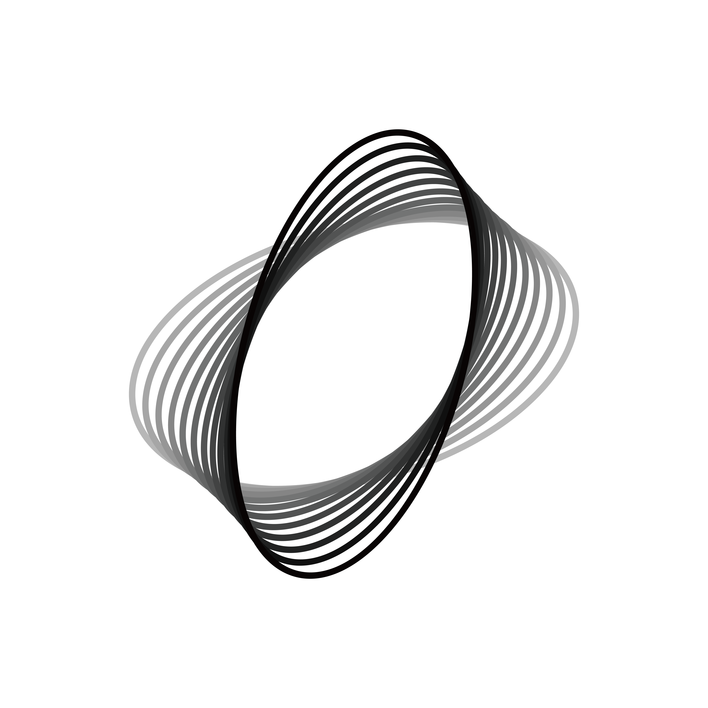

<p align="center"></p>
<h1 align="center">Zerith VA</h1>
<p align="center">Vision–language–action model for robot control</p>
<p align="center"><strong>English</strong> · <a href="README_zh-CN.md">简体中文</a></p>

Zerith VA is a vision–language–action model for robot control. This repository
provides data preparation, post-training, policy export, benchmark evaluation
and H1 deployment tools.

## Overview

- **Benchmark post-training:** LIBERO, LIBERO-Plus, MetaWorld, RoboTwin and RoboDojo.
- **Policy evaluation:** exported policies served over HTTP and evaluated with benchmark simulators.
- **H1 deployment:** GPU inference and a robot controller with camera, SDK and FK/IK integration.

| Component | Purpose |
| --- | --- |
| [simulation/](simulation/) | Data preparation, training, export and evaluation |
| [deployment/shared/](deployment/shared/) | HTTP client and shared interfaces |
| [deployment/inference/](deployment/inference/) | Model loading, visual encoders and inference service |
| [deployment/robot/](deployment/robot/) | H1 SDK integration and robot control |

Model checkpoints are not included in this repository; Zerith VA weights are
planned for a separate release. Datasets and encoder assets are obtained from
their upstream projects. Simulation exports use benchmark-specific action
interfaces; H1 deployment requires a compatible H1 checkpoint.

## Installation

For simulation workflows, use Linux, a CUDA GPU and a Conda environment.
From the repository root:

```bash
conda create -n zvla-train python=3.12 pip
conda activate zvla-train
cd simulation
python -m pip install torch==2.10.0 torchvision==0.25.0 --index-url https://download.pytorch.org/whl/cu130
python -m pip install megatron-core==0.19.0
python -m pip install -r requirements.txt
python -m zvla.posttrain --help
```

Run the simulation CLI from `simulation/`; no project installation is required.
Install the selected simulator in its own environment. See the
[simulation guide](docs/simulation.md) for encoder assets, datasets and
benchmark-specific setup.

## Quick start

The following LIBERO-Plus example assumes the demonstration dataset, Wan/VGGT
assets and a compatible base checkpoint are available at the paths shown.
Asset versions and download commands are listed in the
[simulation guide](docs/simulation.md#required-assets).

From `simulation/`, prepare the dataset and launch training:

```bash
python -m zvla.posttrain prepare --bench libero-plus \
  --source data/raw/libero-plus --output data/libero-plus \
  --wan-repo assets/Wan2.2 --wan-model assets/Wan2.2-TI2V-5B \
  --vggt-repo assets/vggt --vggt-model assets/VGGT-1B --device cuda:0

python -m zvla.posttrain train --bench libero-plus --data data/libero-plus \
  --checkpoint checkpoints/zvla-base.safetensors --output runs/libero-plus \
  --gpus 8 --batch-size 10
```

`--gpus` is the number of GPUs per node; `--batch-size` is per GPU. Adjust both
for your hardware. The guide covers [training and resume](docs/simulation.md#training),
[policy export and serving](docs/simulation.md#export-and-serve), and
[benchmark evaluation](docs/simulation.md#evaluation).

## H1 deployment

Install the deployment packages by host, from the repository root:

```bash
# GPU inference host, with a compatible CUDA/PyTorch environment
python -m pip install ./deployment/shared ./deployment/inference

# H1 host, with the SDK-compatible Python environment
python -m pip install ./deployment/shared ./deployment/robot
```

The GPU host runs the model service. The H1 host runs camera capture, state
estimation and joint control without requiring PyTorch or model weights.
Hardware operation requires the H1 SDK, a compatible IK provider, robot
assets and on-site commissioning. Follow the [H1 deployment guide](docs/deployment.md)
for configuration, connection checks and controller startup.

## Documentation

| Guide | English | 简体中文 |
| --- | --- | --- |
| Data, training and evaluation | [Simulation guide](docs/simulation.md) | [仿真指南](docs/simulation_zh-CN.md) |
| H1 inference and robot control | [Deployment guide](docs/deployment.md) | [部署指南](docs/deployment_zh-CN.md) |

For development and local checks, see [Contributing](CONTRIBUTING.md).
Report security issues through the process in [SECURITY.md](SECURITY.md).

## License

Project code is licensed under [Apache-2.0](LICENSE), which permits commercial
use under its terms. Third-party components retain their own licenses; see
[LICENSE_POLICY.md](LICENSE_POLICY.md) and [NOTICE](NOTICE).

Model weights have separate licensing terms. Commercial use of future
Zerith-owned weights is subject to a separate written license, as described
in [MODEL_LICENSE_POLICY.md](MODEL_LICENSE_POLICY.md).
