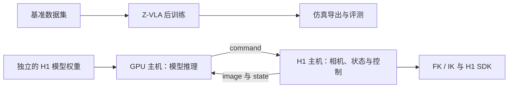

<p align="center">
  
</p>

<h1 align="center">Zerith-VA</h1>

<p align="center">仿真后训练与独立部署的 H1 机器人推理系统</p>

<p align="center"><a href="README.md">English</a> · <strong>简体中文</strong></p>

本仓库汇集了 Z-VLA 仿真基准后训练流程和独立的 ZWAM H1 真机部署系统。真机推理运行在
GPU 主机，机器人控制运行在 H1 主机，两者通过有版本约束的 HTTP 协议通信。

> [!NOTE]
> 当前为源码发布候选。仓库不包含模型权重、数据集、视觉资产、机器人 SDK
> 二进制文件或机器人描述文件。公开发布前请完成[发布核对清单](RELEASE_CHECKLIST.md)。

模型权重将单独发布在 Hugging Face：
[模型仓库（占位链接）](https://huggingface.co/REPLACE_WITH_ORG/Zerith-VA)。
权重上线时会替换此链接；目前它不是可用的下载地址。各模型发布时会附带明确的
使用权限和许可协议，源码许可证不授予这些权重的使用权。

## 仓库结构

| 组件 | 内容 | 运行位置 |
| --- | --- | --- |
| [仿真后训练](#仿真后训练) | 数据准备、Z-VLA 后训练、导出与评测 | 训练及仿真环境 |
| [共享客户端](deployment/shared/) | 协议、HTTP 客户端和公共命令行入口 | GPU 与机器人主机 |
| [模型推理](deployment/inference/) | H1 模型、资产加载与 HTTP 服务 | GPU 主机 |
| [机器人控制](deployment/robot/) | H1 相机与 SDK 适配、FK/IK 检查及控制循环 | H1 主机 |

仿真流程覆盖 LIBERO、LIBERO-Plus、MetaWorld、RoboTwin 和 RoboDojo。
三个部署包可以分别安装：机器人主机无需 PyTorch 或推理权重，GPU 主机无需 H1 SDK。

## 系统架构



这两条模型路径不共用权重。仿真导出采用基准任务对应的状态与动作表示；
H1 部署需要单独训练的权重，以及匹配的归一化参数、视觉资产与文本编码库。
仿真导出物不能直接用作 H1 策略。

## 仿真后训练

以下命令在 `simulation/` 目录执行。

从 `zvla-base.safetensors` 开始，对 LIBERO、LIBERO-Plus、MetaWorld、RoboTwin 和 RoboDojo 做后训练。每个 benchmark 独立拟合自己的状态/动作统计。训练使用 Megatron-FSDP；单机、多机均由 `torchrun` 启动，**不使用梯度累积**。

### 安装

克隆本仓库后，直接从 `simulation/` 源码目录运行公开仿真流程。
用 Conda 分别管理数据准备/训练/模型服务的核心环境，以及各个按需选用的官方模拟器环境。
核心环境建议 Python 3.12，PyTorch 2.10.0、CUDA 13.0、Megatron-Core 0.19.0：

```bash
conda create -n zvla-train python=3.12 pip
conda activate zvla-train
cd /path/to/Zerith-VA/simulation
python -m pip install torch==2.10.0 torchvision==0.25.0 --index-url https://download.pytorch.org/whl/cu130
python -m pip install megatron-core==0.19.0
python -m pip install -r requirements.txt
```

本项目源码无需 pip 安装。轻量 HTTP 客户端只需在模拟器 Conda 环境中具备 NumPy 和 requests。
只安装选中的官方平台、原生依赖和资产。LIBERO 与 LIBERO-Plus 使用各自对应的
官方源码及环境；MetaWorld 使用其自身环境；RoboTwin 与 RoboDojo 按官方 harness
安装，RoboDojo 还需对应的 XPolicyLab/conda 环境。仿真平台库在选中该 benchmark
时才加载。源码包含本项目训练 launcher、benchmark recipe 生成器及评测 bridge 脚本/配置；
外部模拟器源码、模型和资产单独安装。

独立 HTTP 客户端/launcher 可使用 `simulation/environment-client.yml`，
其中仅提供 Python 3.11、NumPy 和 requests。从 `simulation/` 目录创建：

```bash
conda env create -n zvla-client -f environment-client.yml
```

该环境可作为 RoboDojo `POLICY_ENV` 等角色的基础，再按官方要求补充对应
XPolicyLab 依赖。各官方模拟器仍使用自身环境和 Python 约束。

注意力路径对符合条件的 Hopper SM90、FP16/BF16、128 维 head 和布尔 mask 优先使用可选的自定义 FlashAttention-3；其他情况使用 PyTorch SDPA。仿真源码树包含扩展源码、固定版本的 CUTLASS 头文件及上游署名、许可证。GPU 数量不固定，但模型和优化器仍需足够的总显存。更多卡数不会自动增加梯度累积。

在 Hopper GPU 上预编译可选扩展，需要匹配的 CUDA toolkit（含 `nvcc`）、C++ 编译器和 Ninja。在仿真环境中运行：

```bash
python -m pip install ninja
python -c 'from fa2_custom_mask import prebuild_flash_attention3; print(prebuild_flash_attention3())'
```

符合条件的调用可在首次使用时编译扩展，编译失败则回退 SDPA。设置 `ZVLA_REQUIRE_FLASH_ATTENTION3=1` 可要求布尔 mask 调用使用扩展，并在布局不支持或构建失败时报错。构建缓存按源码和 Python/PyTorch/CUDA ABI 指纹隔离。默认使用包内 CUTLASS；`ZVLA_FA3_CUTLASS_ROOT` 仅可选择通过相同指纹检查的固定版本源码副本。切换后端可能改变数值结果、速度和显存占用；GPU 编译与一致性验证留到后续实际验证阶段。

数据准备与在线推理还需要公开的 Wan VAE/UMT5 和 VGGT。模型权重与源码分别下载，放在自己选定的目录。
开发者自行保证数据准备与在线推理使用一致的 Wan VAE、UMT5/tokenizer、VGGT 及预处理约定。

```bash
mkdir -p assets
git clone https://github.com/Wan-Video/Wan2.2.git assets/Wan2.2
git -C assets/Wan2.2 checkout 42bf4cfaa384bc21833865abc2f9e6c0e67233dc
git clone https://github.com/facebookresearch/vggt.git assets/vggt
hf download Wan-AI/Wan2.2-TI2V-5B --revision 921dbaf3f1674a56f47e83fb80a34bac8a8f203e --local-dir assets/Wan2.2-TI2V-5B
hf download facebook/VGGT-1B --local-dir assets/VGGT-1B
```

将提供的 `zvla-base.safetensors` 放入 `checkpoints/`。训练直接加载其中的网络权重。目标 benchmark 的 codec 来自下述准备流程产生的 `codec.json`。

### 公开数据

| benchmark | 数据源 | `--source` 指向 |
|---|---|---|
| `libero` | [openvla/modified_libero_rlds](https://huggingface.co/datasets/openvla/modified_libero_rlds)，revision `6ce6aaaaabdbe590b1eef5cd29c0d33f14a08551` | 四套任务的 RLDS 根目录 |
| `libero-plus` | [Sylvest/libero_plus_lerobot](https://huggingface.co/datasets/Sylvest/libero_plus_lerobot)，revision `22c57433fef692b5b9ecc0795344daac7fa867a5` | 含 `meta/info.json` 的 LeRobot 根目录；只读取 train split |
| `metaworld` | [MINT-SJTU/Evo1_MetaWorld_Dataset](https://huggingface.co/datasets/MINT-SJTU/Evo1_MetaWorld_Dataset)，revision `612c4e83d0e3b4e0be5227970bd8f5f07fc0c488` | 含 `meta/info.json` 的 LeRobot 根目录 |
| `robotwin` | [TianxingChen/RoboTwin2.0](https://huggingface.co/datasets/TianxingChen/RoboTwin2.0)，revision `981c92aa34d8f94d4cff47e0d5bc2f7d4e0af042` | 含 `dataset/<task>/demo_clean.zip` 的下载根目录 |
| `robodojo` | [RoboDojo-Benchmark/RoboDojo](https://huggingface.co/datasets/RoboDojo-Benchmark/RoboDojo)，revision `91f76c28d93dd20c5fa46ce6a5a1d96a4f384acd` | 解压后的 `ee_lerobot_v30`，含 `meta/info.json` |

MetaWorld 的上述演示集由第三方公开提供。RoboTwin 使用官方 `demo_clean` 标准 HDF5 的 EEF command，RoboDojo 使用官方双臂 EEF LeRobot v3.0 数据。

例如下载 LIBERO-Plus：

```bash
hf download Sylvest/libero_plus_lerobot --repo-type dataset \
  --revision 22c57433fef692b5b9ecc0795344daac7fa867a5 --local-dir data/raw/libero-plus
```

所有 benchmark 使用相同准备命令；改变 `--bench` 和 `--source` 即可：

```bash
python -m zvla.posttrain prepare --bench libero-plus \
  --source data/raw/libero-plus --output data/libero-plus \
  --wan-repo assets/Wan2.2 --wan-model assets/Wan2.2-TI2V-5B \
  --vggt-repo assets/vggt --vggt-model assets/VGGT-1B --device cuda:0
```

`--limit 2` 可先准备两个 episode 检查流程。正式运行用另一个输出目录，不加 `--limit`。

准备中断后，在原来的 `prepare` 命令上增加 `--resume` 继续。程序先对照
`prepare_manifest.json`，核对原始文件、有序 episode（包括 RGB 图像、指令）、
编码器权重、tokenizer、代码、软件设置和 `--limit`，通过后才加载编码器。
已完成 episode 数组和最终数据文件也会核对内容哈希。校验一致时复用已完成的
episode，未完成的 episode 重新编码；整个数据集已完成时只校验，不加载编码器，
不改写文件。恢复仍需读取、计算文件哈希，并在 CPU 上解码图像，大数据集的校验需要时间。

输入、模型资产、配置或软件环境变化时使用新输出目录。缺少校验记录的旧缓存，
以及损坏的已完成缓存，都会报错。准备期间保持源数据和模型文件不变，输出目录
须与源数据、编码器源码及权重目录分开。权重文件可以是指向下载 blob 的符号链接，
内部的目录符号链接会被拒绝，避免漏掉输入。每个输出目录同时只允许一个准备进程。
episode、统计和文本文件成功提交后，才会生成最终 `dataset.json`；准备成功后再启动训练。

准备结果包含 `dataset.json`、`codec.json`、`tasks.json`、`text_embeddings.npy` 和逐 episode 数组。状态、动作、掩码使用 FP32/bool，VAE/VGGT/文本缓存使用 FP16。文本最多 64 个有效 token。缓存可能很大，尤其 RoboTwin 的逐 episode 语言表；请留足存储空间。准备流程一次使用一张 GPU，逐 episode 编码。

原生动作每四行对应一个因果视觉 anchor。每个样本预测 16 行，评测执行前四行；尾部不足的动作和未来图像用掩码排除，绝不跨 episode。LIBERO/Plus 使用原生 OSC7，MetaWorld 使用 clipped Native4，双臂任务使用绝对 EEF command，经目标机器人 codec 转成相对动作。MetaWorld 保持先均匀抽 episode、再均匀抽其中 anchor 的采样方式；其余 benchmark 对全部有效 anchor 做分布式打乱和一次遍历。RoboTwin 每个 epoch 从该 episode 的官方 seen instructions 中确定性抽样。

### 训练

```bash
python -m zvla.posttrain train --bench libero-plus --data data/libero-plus \
  --checkpoint checkpoints/zvla-base.safetensors --output runs/libero-plus \
  --gpus 8 --batch-size 10
```

`--gpus` 是每节点卡数，`--batch-size` 是每卡 batch。**全局 batch = 节点数 × 每节点卡数 × 每卡 batch**。任意正整数卡数均可构建拓扑；支持的规模受硬件显存约束。减少卡数时不会保持固定全局 batch，也不会自动缩放学习率。先用较小 batch 检查显存，再按需要调整学习率和步数。

建议起点：

| 项目 | 建议值 |
|---|---|
| LIBERO / LIBERO-Plus / RoboDojo | 30,000 steps |
| MetaWorld / RoboTwin | 50,000 steps |
| 参考全局 batch | 320，例如 4 节点 × 8 卡 × 每卡 10 |
| 基础学习率 | `1e-5` |
| Wan / Reader backbone LR 倍率 | 1 |
| Reader heads / geometry / G4D LR 倍率 | 10 |
| AdamW | betas `(0.9, 0.95)`，weight decay `0.01` |
| 调度 | cosine，5% warmup，最低 LR 为初始值的 10% |
| 梯度裁剪 / 精度 | 1.0 / BF16，优化器主参数 FP32 |
| 动作损失到 Wan 的梯度 | 前 5% 步数为 0，随后 5% 线性增加到 1 |
| checkpoint | 每 1,000 步；保留最近两个恢复点 |

这些是建议起点，不是对不同卡数或数据规模的效果保证。参数可通过 `--steps`、`--learning-rate`、`--batch-size`、`--workers` 修改。`--dry-run` 只打印配置和全局 batch。

多机在每个节点执行相同命令，设置各自的节点序号，例如：

```bash
python -m zvla.posttrain train --bench robotwin --data /data/robotwin \
  --checkpoint /models/zvla-base.safetensors --output /runs/robotwin \
  --nodes 4 --node-rank 0 --gpus 8 --master-addr TRAINING_HOST --master-port 29500
```

`TRAINING_HOST` 是节点 0 的可达主机名。各节点使用相同路径；输出目录须共享。恢复时保留原拓扑、batch、数据及超参，加 `--resume`。恢复包含优化器、调度器、随机数和采样游标。
`train --resume` 只用于自己生成或确认可信的训练目录。

也可直接编辑 `configs/posttrain/*.py` 后执行：

```bash
torchrun --standalone --nproc-per-node 8 scripts/train.py \
  --config configs/posttrain/libero.py --work-dir runs/libero \
  --cfg-options model.pretrained_checkpoint=checkpoints/zvla-base.safetensors
```

### 导出与评测

训练最后一步自动生成 `model-step-*.safetensors`，再导出部署目录：

```bash
python -m zvla.posttrain export --run runs/libero-plus \
  --checkpoint runs/libero-plus/checkpoints/model-step-030000-epoch-XX.safetensors \
  --output artifacts/libero-plus
```

将文件名换成实际生成的文件。导出结果为 `model.safetensors` 和 `manifest.json`，包含目标 benchmark 的 codec 和架构配置。

```bash
python -m zvla.posttrain serve --artifact artifacts/libero-plus \
  --wan-repo assets/Wan2.2 --wan-model assets/Wan2.2-TI2V-5B \
  --vggt-repo assets/vggt --vggt-model assets/VGGT-1B --device cuda:0 --port 8000
```

每个服务进程处理一个 episode。推理端先 `/reset`，首个请求传一帧，随后每次传四个新帧；模拟器客户端会维护这个顺序。UMT5 按需在 GPU 编码语言后移回 CPU，并缓存编码结果。

激活相应官方模拟器的 Conda 环境，确保其中具备 NumPy 和 requests，然后从本仓库的
`simulation/` 目录运行客户端。RoboTwin/RoboDojo launcher 会为官方 harness
子进程把该源码根目录加入 `PYTHONPATH`：

```bash
conda activate YOUR_SIM_ENV
cd /path/to/Zerith-VA/simulation
python -m zvla.posttrain eval --bench libero-plus --benchmark-root /path/to/LIBERO-plus \
  --suite libero_spatial --episodes 1 --server http://127.0.0.1:8000 --output results/plus-spatial
python -m zvla.posttrain eval --bench metaworld --episodes 50 \
  --server http://127.0.0.1:8000 --output results/metaworld
```

LIBERO/Plus 可选 `libero_spatial`、`libero_object`、`libero_goal`、`libero_10`；每条命令运行一套的所有任务。标准 LIBERO 默认每任务 10 次，Plus 默认每任务一次；完整评测需运行四套。Plus 使用其独立的 LIBERO checkout 和配置目录，避免和标准 LIBERO 混用。MetaWorld 使用 `metaworld==3.1.1`、`mujoco==3.3.0`；默认所有 50 任务各 50 个目标、horizon 500，不加 warmup。

RoboTwin 与 RoboDojo 的模拟器和评分由官方 harness 负责。命令会把本包的 policy adapter 复制到指定源码目录，并调用官方入口：

```bash
python -m zvla.posttrain eval --bench robotwin --benchmark-root /path/to/RoboTwin \
  --task adjust_bottle --server http://127.0.0.1:8000 --output results/robotwin
POLICY_ENV=zvla-client EVAL_ENV=robodojo POLICY_GPU=0 ENV_GPU=1 \
python -m zvla.posttrain eval --bench robodojo --benchmark-root /path/to/RoboDojo \
  --task stack_bowls --server http://127.0.0.1:8000 --output results/robodojo
```

RoboTwin adapter 面向 [官方旧版 policy API](https://github.com/RoboTwin-Platform/RoboTwin/tree/bf44be51cf5717a5595ce59447f2cf5263d2aa95)，使用 `demo_clean`、unseen instructions。RoboDojo 对应源码 revision `25691aa78fb34bbbe798aa3d880d57ef2788f696`、XPolicyLab revision `72b3a52f2b069220088ef824ade5890885858379` 的接口。请使用相应版本，安装其官方资产。每条命令评一个任务；官方评分文件保留在其 benchmark 目录，本包输出目录记录启动日志。`POLICY_ENV` 是已补充官方 XPolicyLab 依赖的轻量 HTTP bridge 环境，`EVAL_ENV` 是模拟器环境；请将示例中的环境名替换为实际名称。

### 验证范围

```bash
python -m pytest -q tests
```

本包已验证五种动作/codec 接口、尾部掩码、不同 rank 数的采样与恢复、模型加载及部署回读；小模型通过单卡、双卡优化器更新，以及正式双卡训练入口的 checkpoint 写入、恢复和导出。一个官方 LIBERO-Plus episode 已完成真实 Wan/VGGT/UMT5 编码和数据加载验证。完整模型训练与五套真实闭环评测尚未验证，不以小模型测试代替正式验证。

## 真机部署

H1 部署由三个独立 Python 包组成：`shared` 提供协议与客户端，
`inference` 在 GPU 主机运行模型服务，`robot` 在 H1 主机处理图像、
状态、FK/IK 和 SDK 关节控制。仿真导出权重不能直接作为 H1 权重使用。

### 分主机安装

推理机需要 Linux x86-64、支持 BF16 的 CUDA GPU，以及匹配的模型和视觉资产。
64 GB 内存、约 60 GB 可用磁盘和 48 GB 显存可作为初步规划值，实际需求应
用真实权重测量。在仓库根目录安装：

```bash
python3.10 -m venv .venv
source .venv/bin/activate
python -m pip install torch==2.10.0 torchvision==0.25.0 --index-url https://download.pytorch.org/whl/cu128
python -m pip install ./deployment/shared ./deployment/inference
cd deployment
cp configs/server.example.json configs/server.local.json
cp configs/visual_assets.example.json configs/visual_assets.local.json
```

机器人主机在与 SDK 二进制 ABI 匹配的 Python 环境中，从仓库根目录安装：

```bash
python -m pip install ./deployment/shared ./deployment/robot
cd deployment
zwam robot
cp configs/h1.example.json configs/h1.local.json
```

`zwam robot` 默认只进行离线坐标检查，不初始化 SDK，也不发送运动指令。
此后的部署命令均从 `deployment/` 目录运行，示例配置中的相对路径也相对
该工作目录解析。

### 公开 H1 SDK 与 IK

[Zerith 公开 SDK](https://github.com/inFpZero/zerith_public_sdk) 提供分版本的
运动控制和相机 Python 库。选择与机器人固件和 Python ABI 匹配的版本。
例如 `H1_SDK_1.3.9` 的 Python 3.10 运动库位于
`h1_sdk_v1.3.9_python3.10/lib/`，相机库位于独立的
`camera_sdk_python/camera_client*.so`。SDK 作为外部库单独安装在本地目录，
示例配置使用 `deployment/external/zerith_public_sdk/`。按
`configs/h1.example.json` 分别将 `sdk_root` 和 `camera_sdk_root` 指向
所选版本的运动库与相机库目录，也支持仓库之外的绝对路径。
先安装该 SDK 相机依赖并运行其官方示例。本包只提供项目适配器，
不打包或自动安装 SDK 源码、二进制及厂商示例；SDK 适用其提供方的协议，
不纳入本项目的 Apache-2.0 授权。

公开 SDK 提供相机和电机接口；本项目还需要**单独匹配的原生 IK/规划器、
URDF 和碰撞模型**。通过 `planner_source`、`planner_factory` 指定可信
提供方。适配器要求 `processors.fast_ik_backend`、
`fast_ik_cpp.FastIKSolver`、腰部固定的手臂模型，以及返回
`body_yaw_link` 下双手位姿的 `body_eef_poses(q19)`。仅下载公开 SDK
不足以运行真机闭环控制；必须在目标机器人上核对关节顺序、相机名称、
时间戳时钟和二进制接口。

### 权重、配置与启动

上方 Hugging Face 地址暂为占位链接，待权重单独发布后替换。模型提供方需交付匹配的
`assets/policy/model.safetensors`、`manifest.json`、Wan VAE、
VGGT 源码/权重、文本库及文件哈希。`assets/text/` 中的任务文本必须
与 `text_embeddings.npy` 一一对应，嵌入形状为
`[任务数,64,4096]`，类型为 float16。原始训练 checkpoint 不能代替
部署 bundle；如提供 `fam-wam-policy-v5.2-action20-linear-g4d-teacher`
导出，可执行：

```bash
zwam prepare --source /path/to/exported-policy --output assets/policy
```

H1 部署固定使用现有 Wan2.2 VAE、UMT5 和 VGGT 三相机接口。
打包、策略/会话加载及 `zwam doctor` 会在读取模型权重或初始化 GPU 前检查配置：
`text_dim=4096`、`text_prefix_length=64`、`latent_channels=48`、
`canonical_latent_height=42`、`canonical_latent_width=14`、
`geometry_feature_dim=2048`、`geometry_tokens_per_camera=49`、
`camera_slots=3`、`max_active_camera_slots=3`、`patch_size=2`。
省略接口字段时采用生产默认值；显式提供的尺寸必须为整数，float 或 bool 值会被拒绝。
`text_length` 仍支持大于或等于 64 的整数；较长逻辑文本在前 64 个槽位之后保留全零后缀。
这些接口检查不增加对内部网络宽度、层数或 RoPE 设置的限制。

H1 的训练观测与左右手绝对目标统一采用部署端的 `body_yaw_link` 坐标系。
模型提供方须在 `normalization_stats.command_contract` 中声明该 `pose_frame`
及非空的 `frame_evidence`。打包、离线检查和加载权重前都会拒绝缺失、未知或
其他坐标系的声明。此定义由维护者指定，真实数据及硬件的一致性仍待后续验证；
验证完成前保留 `physical_semantics_verified: false`。代码不执行隐式坐标变换。
统计信息与 checkpoint 绑定，不能只改 manifest 的坐标系名称迁移旧权重；
须从使用正确坐标系的数据导出相互匹配的权重与统计信息。

手部位置单位为米。维护者确认原始训练数据的腰部 `20:23` 槽位依次为
`waist_joint1.position`、`waist_joint2.position`、`waist_joint3.position`，
对应升降（米）、俯仰（弧度）、偏航（弧度）。契约须声明
`position_unit: "m"`、`waist_units: ["m","rad","rad"]` 及上述准确的
`waist_joint_order`。可选的 `waist_semantics` 须为 `["lift","pitch","yaw"]`；
已正确声明单位和顺序的旧统计文件无需增加字段，保持原有哈希。
打包、离线检查与加载会在读取权重前拒绝未知单位或不同顺序。
SDK 映射直接传递这些数值；SDK 实际单位、符号和零点仍需在硬件验证时核对。

在 GPU 主机填写忽略提交的 `configs/server.local.json` 和
`configs/visual_assets.local.json`，填入经过核对的资产路径与 SHA-256：

```bash
zwam doctor --role server --config configs/server.local.json --verify-assets
zwam serve --config configs/server.local.json
```

H1 主机先保持 `commissioned: false`，填写
`configs/h1.local.json`，完成离线检查：

```bash
zwam doctor --role h1 --config configs/h1.local.json
zwam robot --check-server --config configs/h1.local.json
```

`zwam doctor` 不导入 SDK、不连接相机、不移动机器人。非回环地址需要在
两端配置至少 32 字符的 `ZWAM_API_KEY`，并使用 SSH/TLS 保护连接；
不要把密钥写入配置或命令参数。现场验收完成后，才在本地配置中将
`commissioned` 设为 `true`，显式启动：

```bash
bash scripts/start_h1.sh --config configs/h1.local.json --execute
```

操作员输入 `EXECUTE` 初始化，检查姿态和图像，再按 Enter 开始推理。
停止时先停机器人控制端，再停推理服务。Ctrl+C 或
`bash scripts/stop_h1.sh` 执行正常反初始化，可能导致机器人移动；
出现运动危险时使用实体急停。

## 通信与运动约束

服务端接收任务指令、头部/左腕/右腕三路 `image` 和实测 `state`，
返回绝对 `command`。状态与命令均为 23 维：左手位置和旋转占
`0:9`，左夹爪为 `9`；右手为 `10:19`，右夹爪为 `19`；
腰部升降、俯仰、偏航为 `20:23`。位置以
`body_yaw_link` 为基准、单位米；旋转用矩阵前两列的 6D 表示。
夹爪状态范围 0–1，命令范围 0–1.5。

线上协议标识为 `zwam-h1-command23-http-npz-v3`，共享客户端和推理服务端须配套升级。
`GET /health` 声明 v3；客户端检查该元信息，明确拒绝旧版或不兼容协议。
新客户端在所有请求中发送 `X-ZWAM-Protocol: zwam-h1-command23-http-npz-v3`；
服务端对 `POST /reset`、`/infer`、`/release` 在读取请求体或修改会话前拒绝缺失或错误的版本，
`GET /health` 不强制要求此请求头。
请求 NPZ
使用 `images`、`state23`、`valid23` 字段；响应使用
`commands` 和 `valid`。首次请求 1 帧图像，后续每次 4 帧；
模型预测 16 行，服务端返回前 4 行。会话令牌与序号限制请求顺序。
推理请求不会自动重试。推理超时导致状态不明时，先显式重置，再提供新观测。

客户端在发送首次 reset 请求前生成并保留秘密 episode token，通过
`X-Episode-Token` 传递。若 reset 响应丢失，客户端进入 inactive 状态但保留 token；
可在同一客户端显式调用 `reset(prompt, seed)` 重新初始化会话，或调用 `close()`
释放所有权。原 token 持有者在服务端会话 inactive 时仍保持独占；
所有权没有 TTL 过期或其他客户端自动接管机制。

SDK21 关节顺序为左臂 7 + 左夹爪、右臂 7 + 右夹爪、腰 3、头 2；
适配器的 control19 顺序为腰 3、左臂 7、右臂 7、头 2。
真机执行默认关闭。启用前需核对 SDK ABI、机器人版本、URDF/碰撞
模型、FK/IK 坐标系、图像方向及同步、关节限制、现场服务和实体急停。
软件对末端目标、IK 残差、关节步幅和图像新鲜度做检查，但这些检查
不构成厂商安全认证。IK 失败暂停等待操作员处理；部分 SDK 发送失败
保持故障锁定，软件暂停不能代替急停。

## 验证与许可

在仓库根目录运行合成测试及发布树检查：

```bash
pytest -q deployment/tests
PYTHONPATH=simulation python -m pytest -q simulation/tests
python scripts/check_release.py
```

真实权重还需进行 GPU 离线回放、输出与 FK/IK 数值对比、延迟/显存测量，
再对目标 H1 单独验收。Zerith-VA 代码采用 [Apache-2.0](LICENSE)，
来源声明见 [NOTICE](NOTICE) 和[许可范围](LICENSE_POLICY.md)。
Zerith Robotics Logo 经授权用于项目标识，相关权利由公司保留；
该图像不适用代码的 Apache-2.0 许可，本仓库不额外授予品牌使用权。
Zerith Robotics 自有模型权重及其衍生权重用于商业目的，须事先获得
书面许可；本仓库不包含权重，详见[权重政策](MODEL_LICENSE_POLICY.md)。
贡献说明与漏洞报告分别见 [CONTRIBUTING.md](CONTRIBUTING.md) 和
[SECURITY.md](SECURITY.md)。
